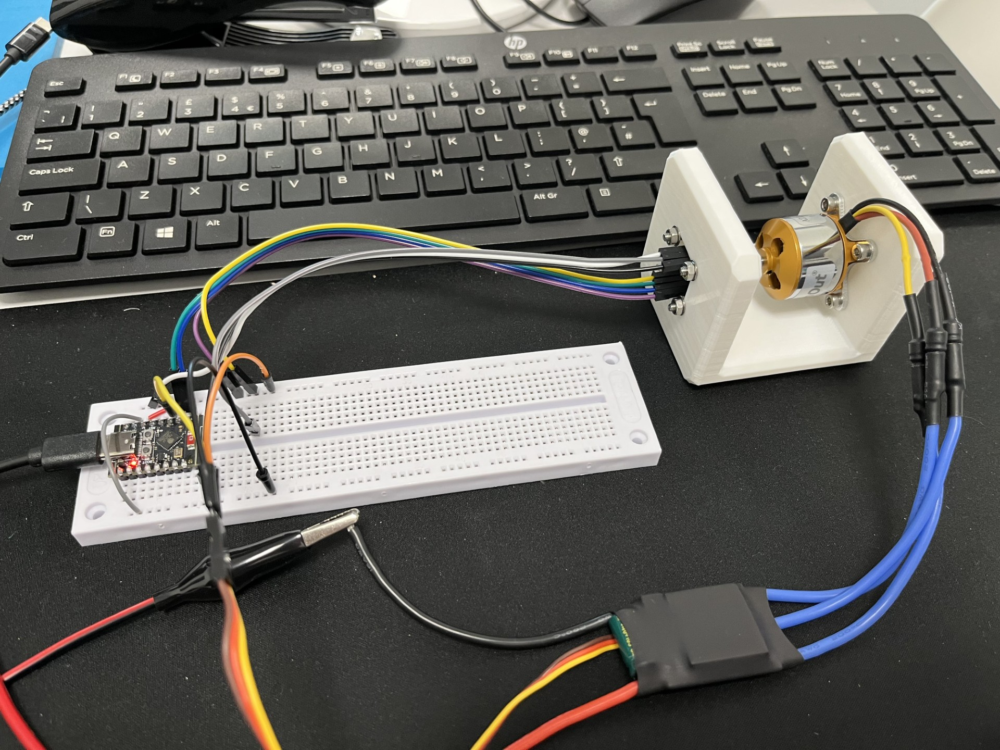

# ESP32-C3 ESC RPM PID Controller

ESP-IDF firmware for an ESP32-C3 that drives a brushless motor ESC with a 400 Hz PWM signal and holds a target RPM using PID control. Speed is measured with an AS5600 magnetic angle sensor over I2C.



## Hardware

| Function | Pin |
|----------|-----|
| ESC signal (PWM) | GPIO2 |
| AS5600 SDA | GPIO0 |
| AS5600 SCL | GPIO1 |
| Status LED | GPIO8 |

- AS5600 I2C address: `0x36` (100 kHz, internal pull-ups enabled).
- ESC pulse range: 1000-2000 us (400 Hz, 14-bit LEDC).

## How it works

- The ESC starts at the minimum pulse with a target of 0 RPM (stopped).
- RPM is computed from AS5600 angle changes every 100 ms.
- The PID output sets the ESC pulse width, with anti-windup on the integral term and a maximum change of 50 us per update.
- If the sensor fails 5 consecutive reads, the target is reset to 0 and the ESC returns to the minimum pulse.
- The LED toggles every 2 seconds.

## Serial commands

Send newline-terminated commands over the serial console:

| Command | Description |
|---------|-------------|
| `<rpm>` | Set target RPM (0-30000). `0` stops the motor. |
| `PID <Kp> <Ki> <Kd>` | Set PID gains (each 0-1000). Saved to flash and restored on boot. |

Example:

```text
3000
PID 0.08 0.40 0.001
```

Default gains: Kp = 0.08, Ki = 0.40, Kd = 0.001. A full flash erase clears the saved gains.

## Build and flash

Requires ESP-IDF (target `esp32c3`).

```text
idf.py set-target esp32c3
idf.py build flash monitor
```

On Windows, [build_flash_monitor.bat](./build_flash_monitor.bat) can be used as a shortcut.

## Safety

- Keep the propeller removed while testing and tuning.
- There is no startup check of the sensor; verify the AS5600 reading is correct before commanding a non-zero RPM.
